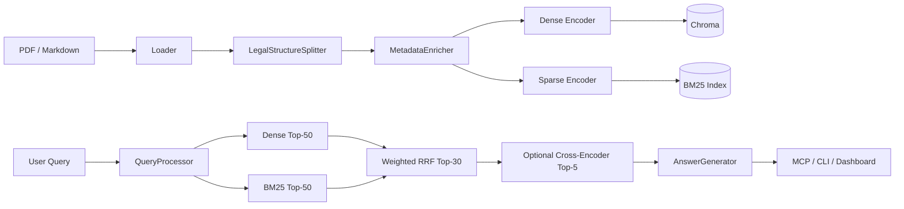

# 劳动法合规知识检索与问答系统

> Labor Law RAG MCP Server · 法条级切块 × 混合检索 × MCP 工具化

面向企业法务、HR 与劳动者的劳动法 RAG 服务：把国家/地方法规、司法解释与典型案例组织成可检索的知识库，支持回答溯源到法规与条款，并通过 MCP 对外提供标准化知识查询能力。

[](https://www.python.org/)
[](https://modelcontextprotocol.io/)
[](https://www.trychroma.com/)
[](#许可证)

---

## 项目简介

传统 RAG demo 通常是“读文档 → 切块 → 向量化 → top-k → LLM”，在劳动法场景会遇到几个具体问题：

- **条款定位不准**：500 字定长块平均混入 3–5 条法条，块边界还会切断法条，条款级问题很难排到第一；
- **精确词召回不稳**：条款号、法规名、百分比这类 token，纯向量容易漏；口语化提问，纯关键词又接不住；
- **地域适用复杂**：同一问题在不同省市规定不同，用户还会混用“工作地 / 公司注册地 / 老家”；
- **效果不可证明**：改了一个参数，指标是涨是跌说不清。

这个项目围绕这些问题做了三件事：

1. **法条级切块 + 上下文头**：按“第 X 条 / 第 X 章”切分，块内拼接《法规名》与章/条信息后再编码；
2. **Dense + BM25 + 加权 RRF**：兼顾语义召回与精确词匹配，并给 Dense 更高权重；
3. **330 条 Golden Set 回归 + MCP 工具化**：让检索效果可量化，让能力可被外部 Agent 调用。

> 这是一个面向学习与作品展示的项目，不是经过大规模生产验证的系统；数据规模、并发与权限模型都按单机知识库设计。

### 核心特性

- **法条级切块**：解析文档 front matter，按“第 X 条/第 X 章”切分；短条合并、长条二次切，避免条款被截断。
- **上下文增强**：每个块带 `context_header`（法规名 + 章 + 条），Dense 与 BM25 都编码该上下文，展示文本保持原文。
- **混合检索**：Dense（Qwen 1024 维）与 BM25 双路各取 50 条，加权 RRF（Dense 2 : Sparse 1）融合到 Top-30，最终 Top-5。
- **可选精排**：内置 Cross-Encoder（`bge-reranker-base`）与 LLM Reranker，默认关闭；CPU 下 30 候选约 15s，建议 GPU 场景开启。
- **MCP 工具化**：3 个 Tool（检索问答、列集合、取文档摘要），返回原文来源、引用与结构化内容。
- **可观测**：JSONL Trace + Streamlit 6 页 Dashboard，覆盖写入、查询、评估三条链路。
- **可评估**：330 条 Golden Set（279 可回答 + 51 库外），Custom Hit@5/MRR + Ragas 双轨评估，支持 `--retrieval-only` / `--no-ragas` / `--no-rerank` 做消融。

### 当前效果

作者本地语料：110 份文档（106 个 Markdown + 4 个 PDF），2984 个切片（其中 2706 个带法条结构）。

| 版本 | 切块 | 融合 | Hit@5 | MRR |
|---|---|---|---:|---:|
| 基线 | 500 字定长块（1423 块） | RRF k=60，等权 | 73.48% | 55.01% |
| **当前** | **法条级 + 上下文头（2984 块）** | **加权 RRF，k=5，Dense 2 : Sparse 1** | **94.62%** | **85.30%** |

- 表内成绩为 **无 rerank** 结果（`rerank.enabled=false`），评估集为 330 条 Golden Set，指标为 source-level Hit@5 / MRR。
- 分项参考（p0 2976 版本）：single 93.6 / 84.0，cross-document 96.2 / 91.2，hard-negative 92.9 / 85.8，region 96.2 / 80.4。
- **复现说明**：仓库不包含 110 份法规原文（体积与版权原因），上述数字来自作者本地语料；要复现，需要自备文档，并保持文件名与 Golden Set 的 `expected_sources` 一致。

---

## 架构



分层：

- `src/core/`：数据契约、配置、查询引擎、响应组装；
- `src/ingestion/`：6 阶段写入流水线；
- `src/libs/`：LLM / Embedding / VectorStore / Reranker / Splitter / Loader / Evaluator 适配层；
- `src/mcp_server/`：MCP stdio Server 与 3 个 Tool；
- `src/observability/`：Trace、评估、Streamlit Dashboard；
- `scripts/`：摄入、检索、评估、Dashboard 启动脚本。

---

## 快速开始

### 1. 环境要求

- Python 3.10+
- 可用的 LLM / Embedding API（默认 DeepSeek + Qwen）
- 可选：本地 Ollama（用于图片 caption；没有也能处理纯文本）

### 2. 安装

```bash
git clone <your-repo-url>
cd MODULAR-RAG-MCP-SERVER

python -m venv .venv

# Windows PowerShell
.venv\Scripts\Activate.ps1

# Linux / macOS
# source .venv/bin/activate

pip install -e ".[dev]"
```

### 3. 配置 API Key

在项目根目录创建 `.env`（已在 `.gitignore` 中）：

```dotenv
DEEPSEEK_API_KEY=sk-...
QWEN_API_KEY=sk-...
```

`config/settings.yaml` 通过 `${DEEPSEEK_API_KEY}` / `${QWEN_API_KEY}` 读取。完整配置见 [`config/settings.yaml`](config/settings.yaml)。

### 4. 准备语料并入库

把 `.md` 或 `.pdf` 法规文档放到 `data/uploads/<name>/`，例如：

```bash
mkdir -p data/uploads/default
# Windows PowerShell: New-Item -ItemType Directory -Force data\uploads\default
```

然后执行摄入：

```bash
python scripts/ingest.py \
  --path data/uploads/default \
  --collection legal \
  --force
```

`--collection` 是逻辑集合名，会用于：

- Chroma collection；
- `data/db/bm25/{collection}/`；
- 后续检索与评估的 `--collection` 参数。

> 仓库中的 `data/` 被 `.gitignore` 忽略；仅 `tests/fixtures/sample_documents` 保留了少量示例文档，可用于冒烟测试。

### 5. 命令行检索

```bash
python scripts/query.py \
  --query "竞业限制期限最长不得超过多久？" \
  --collection legal \
  --top-k 5 \
  --no-rerank
```

输出会包含 Dense / Sparse / 融合 / 重排各阶段结果，便于调试。

### 6. 运行评估

```bash
# 只跑检索指标：快、无 LLM 生成成本
python scripts/evaluate_golden.py \
  --collection legal \
  --top-k 5 \
  --retrieval-only \
  --no-ragas \
  --no-rerank

# 四组消融：dense / sparse / hybrid / hybrid+rerank
python scripts/eval_compare.py \
  --collection legal \
  --top-k 5
```

完整评估（生成答案 + Ragas）会调用 LLM judge，耗时与费用更高：

```bash
python scripts/evaluate_golden.py --collection legal --top-k 5
```

### 7. 启动 Dashboard

```bash
python scripts/start_dashboard.py --port 8501
```

浏览器打开 `http://localhost:8501`。包含 Overview、Data Browser、Ingestion Manager、Ingestion Traces、Query Traces、Evaluation Panel 六个页面。

### 8. 接入 MCP

MCP Server 入口：

```bash
python -m src.mcp_server.server
```

VS Code 可在 `.vscode/mcp.json` 中配置（Cursor 使用 `.cursor/mcp.json`，字段相同）：

```json
{
  "servers": {
    "labor-law-rag": {
      "type": "stdio",
      "command": "${workspaceFolder}\\.venv\\Scripts\\python.exe",
      "args": ["-m", "src.mcp_server.server"],
      "cwd": "${workspaceFolder}"
    }
  }
}
```

- macOS / Linux 把 `command` 换成 `${workspaceFolder}/.venv/bin/python`。
- Claude Desktop 使用 `mcpServers` 字段，配置内容相同。
- 调用 `query_knowledge_hub` 时，通过 `collection` 参数指定集合（例如 `legal`）；不传则使用工具默认值。

> 根目录 `main.py` 目前是早期脚手架占位入口；启动 MCP 服务请使用 `python -m src.mcp_server.server`。

---

## 配置说明

核心参数（完整见 [`config/settings.yaml`](config/settings.yaml)）：

```yaml
llm:
  provider: "deepseek"
  model: "deepseek-chat"

embedding:
  provider: "qwen"
  model: "text-embedding-v3"
  dimensions: 1024

vector_store:
  provider: "chroma"
  persist_directory: "./data/db/chroma"
  hnsw_sync_threshold: 1000000

retrieval:
  dense_top_k: 50
  sparse_top_k: 50
  fusion_top_k: 30
  rrf_k: 5
  dense_weight: 2.0
  sparse_weight: 1.0

rerank:
  enabled: false
  provider: "cross_encoder"
  model: "BAAI/bge-reranker-base"
  top_k: 5
```

环境变量：

| 变量 | 用途 | 是否必需 |
|---|---|---|
| `DEEPSEEK_API_KEY` | 生成答案、Ragas judge | 是（除非换 provider） |
| `QWEN_API_KEY` | Dense embedding | 是（除非换 provider） |

说明：

- `vector_store.collection_name` 是默认集合名；`scripts/*` 的 `--collection` 会覆盖它。MCP 调用通过 `collection` 参数指定。
- `hnsw_sync_threshold` 用于规避 `chromadb 1.5.9` 的 HNSW 重载问题：把向量保留在 sqlite log，新进程启动时重放；旧 collection 需要重新 ingest。
- `rerank.enabled=false` 是当前默认值；CPU 上开启会显著变慢，建议 GPU 场景使用。
- `vision_llm` 默认 Ollama `llava`；不可用时只会跳过图片 caption，不影响纯文本摄入。

---

## 工作原理

### 写入链路（6 个 Stage）

1. **完整性检查**：SHA256 写入 SQLite，已处理文件跳过；`--force` 重跑。
2. **加载**：`.pdf → PdfLoader`，`.txt/.md → TextLoader`；PDF 抽图并以 `[IMAGE: id]` 占位。
3. **切分**：`DocumentChunker` 优先调用 `LegalStructureSplitter`：
   - 解析 YAML front matter（title/doc_no/effective_date/status 等）；
   - 按“第 X 条 / 第 X 章”切分；
   - 短条合并（≤200 字），长条按 `。`/`；` 二次切（重叠 50 字）；
   - 无“第 X 条”结构时回退到 `recursive`；
   - 生成 `context_header = 《法规名》+ 章 + 条`。
4. **Transform**：规则清洗、metadata 增强（保留文档标题，补 `chunk_title` / `region` / `authority_level`）、图片 caption。
5. **编码**：Qwen 1024 维 Dense + BM25 统计量；编码文本是 `context_header + 正文`，展示文本仍是原文。
6. **存储**：Chroma + BM25 倒排 + 图片索引；BM25 的 `chunk_id` 回填为 Chroma 的 vector id，保证稀疏命中能回表取正文。

### 查询链路

1. `QueryProcessor`：jieba 分词 + 中英停用词 + key:value 过滤；
2. Dense 与 BM25 并行召回各 50 条；
3. 单路失败自动降级，双路失败抛错；
4. 加权 RRF：`score(d) = Σ w_i / (k + rank_i)`，`k=5`，Dense 2.0 : Sparse 1.0，融合到 Top-30；
5. 可选 Cross-Encoder 精排到 Top-5（默认关闭）；
6. `AnswerGenerator`（DeepSeek）生成带引用的答案，资料不足时固定拒答；
7. `ResponseBuilder` 输出 Markdown + citations + 结构化内容 + 图片块；
8. Trace 写 JSONL；
9. MCP 返回 `CallToolResult`。

### MCP Tools

| Tool | 作用 |
|---|---|
| `query_knowledge_hub` | 混合检索 + 可选重排 + 可选生成，返回带引用的结果 |
| `list_collections` | 列出知识集合与规模 |
| `get_document_summary` | 按 `doc_id` 取标题、摘要、标签、来源、块数 |

---

## 评估

### Golden Set

330 条，分为：

| 类型 | 数量 | 说明 |
|---|---:|---|
| single_point | 172 | 单点事实/条款问题 |
| cross_document | 53 | 需要跨文档对照 |
| hard_negative | 28 | 相近法规/条款混淆 |
| hard_negative_region | 26 | 工作地/注册地/户籍地混淆 |
| unanswerable | 51 | 知识库外问题 |

- Ground truth 采用“文件名 + 可选条款号”，不绑定 `chunk_id`；改切分参数不会让评估集失效。
- 当前有 18 条 clause-level（文件名 + 第X条）用例。

### 指标

- `Hit@5`：Top-5 是否命中至少一个期望来源；
- `MRR`：第一个命中的排名倒数；
- `empty_recall` / `abstention_rate` / `hallucination_rate`：只对库外用 example 计算；
- Ragas：`faithfulness` / `answer_relevancy` / `context_precision` / `context_recall`。

### 注意事项

- 仓库不包含 110 份法规原文，数字来自作者本地语料；没有同名单文件时，`evaluate_golden.py` 的命中率没有可比性。
- 最新成绩只跑了 Custom 检索指标；Ragas 旧版 45 条数据已过期，需重新运行后再引用。
- 当前 `empty_recall` 结构性地为 0：混合检索对任何 query 都会返回 Top-5，除非增加相关性阈值/拒答策略。
- 330 条是回归集，不是 Benchmark；p≈0.9 时 95% CI 约 ±4 个点。

---

## 项目结构

```text
MODULAR-RAG-MCP-SERVER/
├── config/
│   ├── prompts/                 # 生成、重排、切块精炼、图片 caption 的 prompt
│   └── settings.yaml            # 全局配置
├── data/                        # 本地数据（gitignore）
│   ├── uploads/                 # 待摄入文档
│   ├── db/chroma/               # Chroma 持久化
│   └── db/bm25/                 # BM25 索引
├── src/
│   ├── core/                    # 契约、配置、查询引擎、响应组装
│   ├── ingestion/               # 6 阶段写入流水线
│   ├── libs/                    # LLM/Embedding/VectorStore/Reranker/...
│   ├── mcp_server/              # MCP Server + 3 Tools
│   └── observability/           # Trace、评估、Dashboard
├── scripts/
│   ├── ingest.py
│   ├── query.py
│   ├── evaluate_golden.py
│   ├── eval_compare.py
│   └── start_dashboard.py
├── tests/
│   ├── unit/
│   ├── integration/
│   ├── e2e/
│   └── fixtures/                # Golden Set、示例文档
├── DEV_SPEC.md                  # 设计与任务规格
└── pyproject.toml
```

---

## 已知限制

| 限制 | 说明 |
|---|---|
| 数据未入库 | 110 份法规原文不在仓库；复现指标需自备同名单文档 |
| 地域未硬过滤 | 已抽 `region` / `authority_level`，但检索还没按“工作地优先”做 filter/boost |
| 库外指标不完整 | `empty_recall` 结构性为 0；拒答率需要相关性阈值后才能有意义 |
| Chroma HNSW | `chromadb 1.5.9` 在某些环境无法重载落盘 HNSW；当前用 `hnsw_sync_threshold` 规避，旧集合需重灌 |
| CPU 精排慢 | `bge-reranker-base` 30 候选约 15s；默认关闭，GPU 场景再开 |
| 双写最终一致 | Chroma 与 BM25 两次独立写，中断可能不一致；改进方向是批次状态机 + 补偿 |
| BM25 全量 reload | 每次查询读 JSON；小语料可接受，上量需换 ES/常驻内存 |
| `main.py` 占位 | MCP 入口以 `python -m src.mcp_server.server` 为准 |

---

## Roadmap

- [ ] 地域感知检索：工作地优先的 filter/boost，降低 region 混淆。
- [ ] 拒答阈值：基于 top1 分数 / top1-top2 margin，让库外指标可评估。
- [ ] Query 改写：指代消解、同义扩展、多 query 召回。
- [ ] GPU 精排：Cross-Encoder 批量化 + 超时预算。
- [ ] 评估扩展：1000+ Golden Set、bootstrap 置信区间、Ragas 重跑。
- [ ] 存储扩展：Milvus/pgvector + Elasticsearch/OpenSearch。
- [ ] 写入一致性：批次状态机 + 失败补偿。

---

## 测试

仓库包含 1200+ 单元/集成/E2E 测试用例：

```bash
# 单元测试
python -m pytest tests/unit -q

# 跳过需要真实 LLM API 的测试
python -m pytest -m "not llm" -q

# 全量
python -m pytest -q
```

部分集成/E2E 测试需要索引数据或 API Key；没有配置时会自动 skip。

---

## 来源与许可

本项目基于 [jerry-ai-dev/MODULAR-RAG-MCP-SERVER](https://github.com/jerry-ai-dev/MODULAR-RAG-MCP-SERVER) 修改。
原始代码版权归原作者；本仓库新增的法条级切块、加权 RRF、330 条 Golden Set 与评测由本人完成。

原仓库未附带 LICENSE 文件；当前仓库为私有，仅用于个人学习与作品展示，不对外分发。
如需公开或商用，请先联系原作者确认授权。